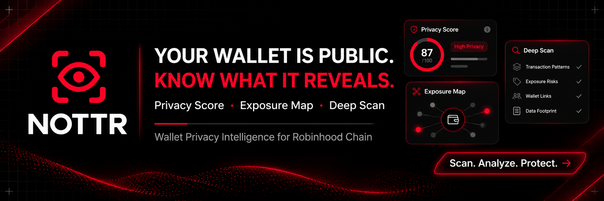

<p align="center">
  
</p>

<p align="center">
  <strong>Wallet Privacy Intelligence for Robinhood Chain</strong><br />
  See what the chain reveals. Understand your exposure. Take control of what comes next.
</p>

<p align="center">
  <a href="https://nottr.xyz">Website</a> ·
  <a href="https://nottr.xyz/dashboard">Launch app</a> ·
  <a href="https://robinhoodchain.blockscout.com/address/0xd4531a83a8b29d54aab30428f99de889e9e0fc54">$NOTTR contract</a>
</p>

## What is NOTTR?

Blockchain activity is public. Transfers and interactions can reveal patterns and connections that are easy to overlook. NOTTR is a wallet privacy intelligence platform that makes those onchain signals easier to explore and understand.

Enter an EVM address to scan its activity on Robinhood Chain. NOTTR organizes the returned records into an explainable Privacy Score, direct connections and evidence-based findings. The optional AI analyst can help interpret the results and suggest practical next steps.

Public scans do not require a wallet connection. Users can sign in with email or a wallet to access their workspace.

## How it works

1. **Scan an address.** Enter a valid `0x...` address. NOTTR requests activity from Robinhood Chain.
2. **Explore the evidence.** Review returned records, direct counterparties and transaction links.
3. **Understand the score.** Inspect the factors used to calculate the experimental Privacy Score and the coverage of the scan.
4. **Ask NOTTR Analyst.** Signed-in users can request an additional AI interpretation of a fresh scan.

## What's available

### Wallet scans

NOTTR retrieves public activity on Robinhood Chain Mainnet. Alchemy provides native and ERC-20 transfer records when configured. Blockscout provides a fallback for recent transactions. Each result identifies its source, scan time and coverage limits.

### Privacy Score

The score is a deterministic estimate based on observable connectivity in the returned sample. It begins at 100 and deducts points for distinct counterparties, repeated counterparties and concentration of interactions. The interface shows the methodology version and individual factor contributions.

The score requires at least five distinct transactions involving counterparties. It is experimental and has not been independently validated. A higher score represents fewer exposure signals under these rules within the scanned sample; missing data is not treated as evidence of safety.

### Exposure map and signals

The exposure map displays up to eight direct counterparties found in the scan. Findings highlight repeated interactions with supporting transaction links. These relationships describe observed activity; they do not establish that addresses have the same owner.

### NOTTR Analyst

NOTTR Analyst is an optional AI layer for understanding a scan. It can explain observed signals, discuss their limits and suggest practical privacy considerations in a concise, clear voice.

When a user submits a question, the server performs a fresh scan and sends the address, derived findings, score, coverage and question to OpenAI. AI output is an interpretation, can be incorrect and does not change the rule-based Privacy Score. Source transactions remain the evidence for a finding.

### Personal workspace

Privy provides email and wallet sign-in. Signed-in users can review their recent scan history, reuse an address, export history and clear it. They can save two public addresses without connecting a wallet. A Privy-linked wallet holding at least 1,000,000 $NOTTR on Robinhood Chain unlocks up to ten saved addresses. Saving an address does not verify ownership.

### Monitoring and alerts

When configured, a scheduled job scans eligible saved addresses and records observed direct counterparties. It establishes a baseline on the first check, then reports newly observed connections as privacy signals. A newly observed connection may be old activity that was previously outside the returned sample; it does not itself indicate a threat. A separate backfill walks the explorer's transaction, token-transfer and internal-transaction pages and resumes from a checkpoint. The workspace shows progress and provider failures. Coverage still depends on the explorer and does not include offchain connections or a complete approval inventory.

The risk alert infrastructure compares recorded counterparties against a source-backed operator-maintained registry. **No automated threat-intelligence feed is included and this registry starts empty.** Until operators configure and maintain reliable Robinhood Chain indicators, the application cannot identify known scams or send related risk alerts. A match is a reason to inspect the cited evidence, not proof that a wallet is compromised.

Alerts and evidence appear in the account, with a recent-alert count on the workspace overview. Telegram delivery is planned for a later update. The scheduled worker has a finite execution window; deployments need monitoring and sufficient scheduler capacity to meet daily coverage as usage grows. See [monitoring setup](docs/monitoring-setup.md).

## $NOTTR token

| | |
| --- | --- |
| **Token** | `$NOTTR` |
| **Network** | Robinhood Chain Mainnet |
| **Chain ID** | `4663` |
| **Contract** | [`0xd4531a83a8b29d54aab30428f99de889e9e0fc54`](https://robinhoodchain.blockscout.com/address/0xd4531a83a8b29d54aab30428f99de889e9e0fc54) |

The token is part of the NOTTR ecosystem. The optional saved-wallet allowance requires server-side holder verification and a connected, Privy-linked wallet. The application does not transfer or custody tokens.

## Technology

| Layer | Technology | Role |
| --- | --- | --- |
| Application | Next.js, React, TypeScript | Website, workspace and server routes |
| Chain data | Alchemy, Blockscout | Robinhood Chain activity and explorer links |
| Authentication | Privy | Email and wallet sign-in |
| Database | Supabase PostgreSQL | Account scan history and application data |
| AI | OpenAI API, Vercel AI SDK | Optional explanations of scan findings |
| Deployment | Vercel | Application hosting |

The scanner validates the requested address, fetches provider data on the server, calculates the score using versioned rules and returns the result with its coverage. The AI endpoint performs a separate fresh scan before producing an explanation. The browser does not receive the server's service keys.

**Network scope:** Robinhood Chain Mainnet only, chain ID `4663`. NOTTR does not aggregate activity from other networks.

## Coverage and limitations

- The Alchemy scan requests up to 50 incoming and 50 outgoing native and ERC-20 transfer records. Contract calls and internal transfers are excluded.
- The Blockscout fallback returns one page of transactions and does not include token or internal transfers.
- Results represent the records returned by the source, not necessarily a complete wallet history.
- NOTTR does not identify real-world people, hide transactions or guarantee privacy or anonymity.

## What's next

- Broader historical coverage and more evidence-backed signals.
- Further testing and refinement of the Privacy Score and AI analysis.
- Verified-wallet features and extended reports.
- Automated threat-intelligence feeds and broader historical coverage.
- Additional token holder benefits and transparent token-related reporting.
- Continued security, reliability and usability improvements.

These items are planned. Paid reports, subscriptions and automated buyback or burn operations are not currently available. Monitoring and the saved-wallet holder tier require deployment configuration, migrations and verification before use.

## Local development

**Requirements:** Node.js 20.9 or newer, npm and configured service credentials.

```bash
npm install
cp .env.example .env.local
npm run dev
```

Open [localhost:3000](http://localhost:3000). On Windows PowerShell, use `Copy-Item .env.example .env.local` instead of `cp` if preferred.

Set up a Supabase project and run the SQL files in `supabase/migrations` in filename order. Configure a Privy app with email and wallet login, an Alchemy app for Robinhood Chain Mainnet and an OpenAI API key for the analyst. Add the values shown in `.env.example` to `.env.local` or your deployment environment.

```bash
npm test       # Run automated tests
npm run build  # Build the application
```

Keep secret keys on the server and out of source control. See the environment template for the variables expected by this version.
